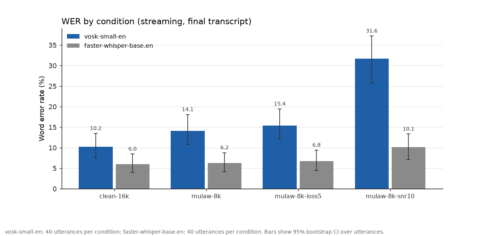
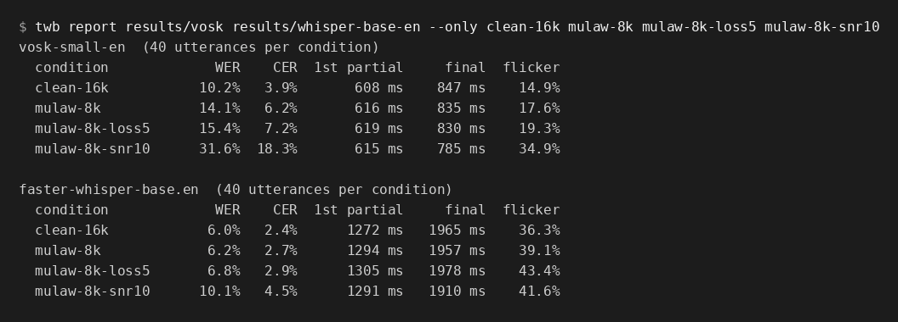
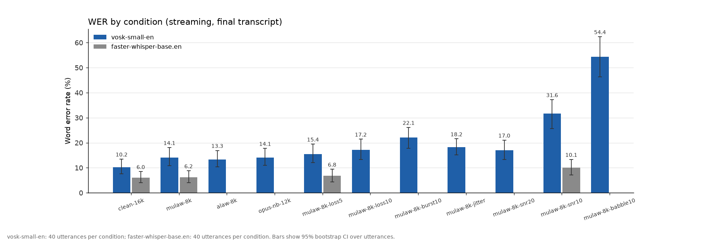
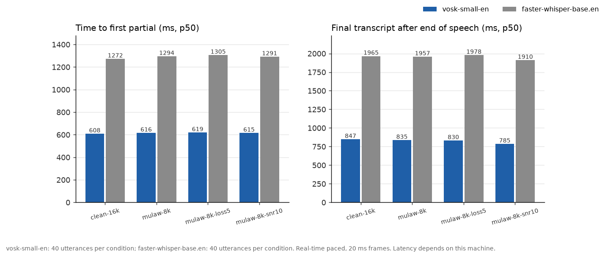
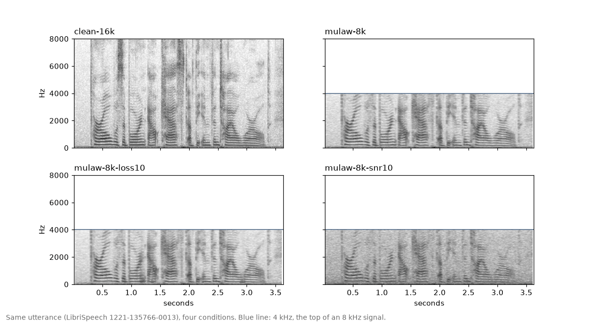
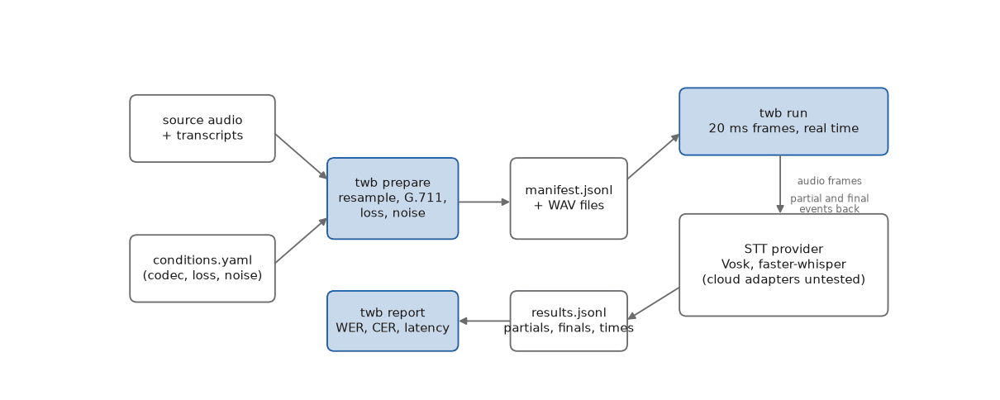

# telephony-wer-bench

Measure how well a streaming speech-to-text service handles phone audio.

`twb` takes clean speech, makes it sound like a phone call (8 kHz, G.711, packet loss, noise, jitter), streams it to your provider in real time, and reports word error rate, latency and how much the partial transcript changes its mind. Every impairment is seeded, so a run can be repeated exactly.

[Landing page](https://telephony-wer-bench.vercel.app) · [Docs](docs/) · Related: [voice-eval-toolkit](https://github.com/AQIB-NAWAB/voice-eval-toolkit)



*Real run: 40 LibriSpeech test-clean utterances (752 words) per condition, two local providers, error bars are 95% bootstrap intervals. Both providers are small local models, so this shows how the tool works, not how a hosted service ranks.*

## Why

Most STT numbers are measured on clean 16 kHz audio. Phone calls are 8 kHz, compressed with G.711 (or Opus), lose packets, and have background noise. Accuracy drops, and latency and stability matter more when a voice agent has to answer in a second. This tool measures those on audio that looks like your calls.

Other tools exist, for example the Pipecat STT benchmark and Bluejay MISTT. See [docs/research.md](docs/research.md) for what they cover and where this one differs (bring your own audio, seeded telephony impairments, latency and partial stability).

## Results from this repo

Provider, sample size and machine are part of the result. All numbers below come from `results/` in this repo and can be regenerated.

- Data: 40 utterances from LibriSpeech test-clean, 3 to 12 seconds each (`twb fetch`, seed 7). Impairment seed 1234.
- Machine: one 8-CPU Linux VM. Audio sent in real time in 20 ms frames, followed by 0.6 s of silence.
- vosk-small-en (Vosk small English model, natively streaming): 6 worker processes.
- faster-whisper base.en, float32: 3 worker processes with 2 threads each. Whisper does not stream, so the bench re-decodes the growing buffer once per second. Its latency reflects that choice.

| Condition | Vosk WER | Whisper WER | Vosk first partial | Whisper first partial | Vosk final | Whisper final |
| --- | ---: | ---: | ---: | ---: | ---: | ---: |
| clean-16k | 10.2% | 6.0% | 608 ms | 1272 ms | 847 ms | 1965 ms |
| mulaw-8k | 14.1% | 6.2% | 616 ms | 1294 ms | 835 ms | 1957 ms |
| mulaw-8k-loss5 (5.2% packets lost) | 15.4% | 6.8% | 619 ms | 1305 ms | 830 ms | 1978 ms |
| mulaw-8k-snr10 (pink noise) | 31.6% | 10.1% | 615 ms | 1291 ms | 785 ms | 1910 ms |

Latencies are medians. "First partial" is measured from the start of speech. "Final" is the time after the end of speech until the last transcript arrives, and it includes the 0.6 s silence tail.



Things to keep in mind:

- 40 utterances is small. The 95% intervals for single conditions are about 3 to 6 points wide, so read differences inside them as noise. The Vosk gap between clean-16k and mulaw-8k (10.2% to 14.1%) is within the interval.
- Vosk's published figure for this model on full test-clean is 9.85%. Our 10.2% on 40 clips is in line with that.
- Nothing here is a ranking of hosted services. Cloud adapters are included but I have not run them (see below).
- Whisper's flicker and latency numbers describe the simple re-decode scheme used here, not Whisper in general.
- An earlier Whisper run used int8 and gave corrupted transcripts under multi-process load. It was discarded and the run was redone in float32. Details in [docs/architecture.md](docs/architecture.md).

More conditions (A-law, Opus narrowband, 10% loss, burst loss, jitter, 20 dB and babble noise) were run for Vosk only:



Latency per condition:



## What the conditions do

The same utterance through four of the conditions:



Order of operations, defaults and fields are in [docs/conditions.md](docs/conditions.md). In short: noise at source rate, resample to 8 kHz, codec (mu-law, A-law, or Opus 12 kbps through ffmpeg), late packets become loss (jitter), random or burst loss, then simple concealment (repeat the last frame with decay).

G.711 is implemented in numpy from the ITU reference. Decoding matches ffmpeg exactly for all 256 codes. Encoding can differ from ffmpeg by one quantization step near segment boundaries, and the tests document that.



## Install

```bash
git clone https://github.com/AQIB-NAWAB/telephony-wer-bench
cd telephony-wer-bench
python -m venv .venv && source .venv/bin/activate
pip install -e ".[vosk,whisper]"      # pick the providers you want
```

Python 3.10 or newer. `ffmpeg` is only needed for the Opus condition.

## Use

```bash
# 1. prepare: applies conditions to the bundled 10-clip sample (no download)
twb prepare --conditions examples/conditions.yaml --out twb-data/prepared

# 2. run: streams in real time to a provider
twb run twb-data/prepared --provider vosk --workers 4 --out twb-runs/vosk

# 3. report: JSON, Markdown and charts
twb report twb-runs/vosk --out twb-report
```

To use more audio, `twb fetch -n 40` downloads LibriSpeech test-clean (about 350 MB) and keeps 40 utterances, or point `--source` at your own folder with a `source.jsonl` or `transcripts.tsv`. Runs are real time, so the wall time is roughly total audio divided by the number of workers.

`twb report` takes several run folders and compares providers side by side. `twb providers` shows which providers can start on your machine.

## Providers

| Provider | Status |
| --- | --- |
| `vosk` | Tested. Local, natively streaming. |
| `whisper` (faster-whisper) | Tested. Local, streaming simulated by re-decoding. |
| `oracle` | Debug only. Reads the reference text, so it cannot be reported. |
| `deepgram` | Untested. Written from the public docs, never run. |
| `assemblyai` | Untested. |
| `openai-realtime` | Untested. |
| `google` | Untested. |
| `azure` | Untested. |

Cloud adapters import their SDKs only when used and read keys from environment variables. If you run one, please open an issue or pull request with what you found. See [CONTRIBUTING.md](CONTRIBUTING.md) to add a provider.

## Metrics

WER and CER with a documented normalizer, per-condition breakdown with bootstrap intervals, time to first partial, final latency, partial stability (retraction and flicker), and real-time factor for local providers. Definitions and caveats: [docs/metrics.md](docs/metrics.md).

## Regenerate the images

```bash
pip install -e ".[dev]"
python scripts/make_images.py
```

This redraws everything in `docs/images/` from the run folders in `results/`. Nothing is typed in by hand.

## Tests

```bash
ruff check .
pytest
```

Covers the codecs, packet loss, normalization, WER math, frame pacing and the report. CI runs on Python 3.10 to 3.13.

## Docs

[research](docs/research.md) · [architecture](docs/architecture.md) · [metrics](docs/metrics.md) · [conditions](docs/conditions.md)

## Data and license

Code is MIT. The bundled sample and the evaluation set come from [LibriSpeech](https://www.openslr.org/12) test-clean (CC BY 4.0, Panayotov et al., 2015). Attribution is in `src/twb/data/sample/LICENSE.txt`.

Built by [Aqib Nawab](https://aqibnawab.vercel.app/).
