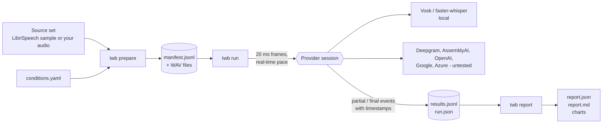
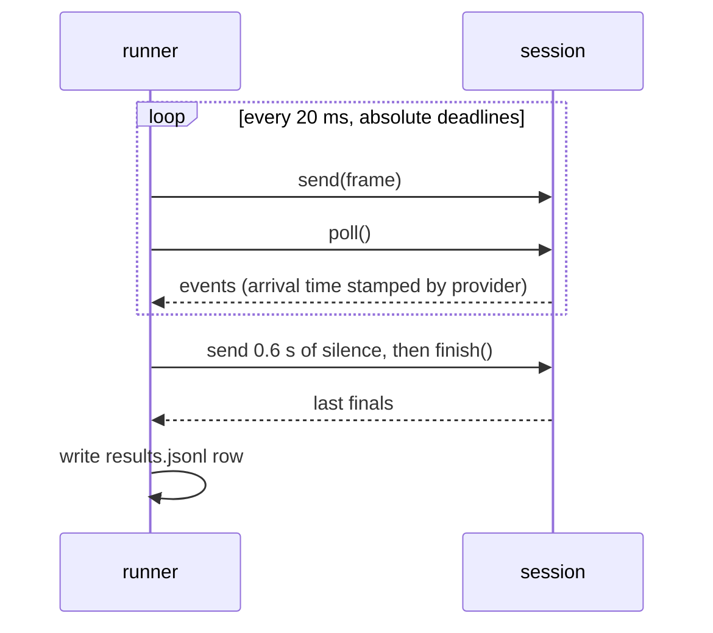

# Architecture



## Modules

| Module | Job |
| --- | --- |
| `audio.py` | Read and write audio, resample, cut into 20 ms frames, energy-based speech bounds |
| `codecs.py` | G.711 mu-law and A-law in numpy, Opus narrowband through ffmpeg |
| `impair.py` | Packet loss masks, concealment, jitter buffer, noise generators, SNR mixing |
| `conditions.py` | Condition schema, validation, deterministic seeds, applying a chain |
| `datasets.py` | Bundled sample, LibriSpeech fetch, loader for your own folder |
| `prepare.py` | Writes WAV files and the manifest |
| `runner.py` | Real-time pacing, session loop, process pool, run output |
| `providers/` | One class per STT provider behind a small `Provider` and `Session` interface |
| `metrics.py`, `normalize.py` | WER, CER, latency, stability, text normalization |
| `report.py`, `plots.py` | Scoring of run folders, bootstrap CI, Markdown, JSON and charts |

## Provider interface

```python
class Session:
    def send(self, pcm: np.ndarray) -> None   # one 20 ms int16 frame
    def poll(self) -> list[RawEvent]          # events since last call, never blocks
    def finish(self) -> list[RawEvent]        # end of audio, wait for finals

class Provider:
    def open(self, sample_rate: int, reference: str | None = None) -> Session
```

Events are stamped with `time.monotonic()` when they arrive, inside the provider, so the runner's 20 ms loop does not add jitter to latency. To add a provider, subclass `Provider`, return a `Session`, and register the class name in `providers/__init__.py`.

## Runner



Worker processes (`--workers N`) each load their own provider and warm it up on one second of silence before the first utterance. Each worker runs one utterance at a time at real-time pace. The provider object is also built once in the parent before the workers start, so a model download happens once.

## Why simulated streaming for Whisper

Whisper is not a streaming model. The bundled provider re-decodes the whole buffer every second and sends each result as a partial. This is the simplest honest way to get a streaming-shaped result from it, and its latency and stability numbers describe that strategy. A production system would use something like LocalAgreement and would flicker less.

## Debug provider

`oracle` reads the reference text and reveals it word by word. It exists so the whole pipeline can be tested without a model or a network. Its WER is zero by construction and it must never be reported as a result.

## Known issue: faster-whisper int8 gave corrupted text under load

The first full run of the Whisper provider used `compute_type="int8"` with three worker processes. A few transcripts came back corrupted: random wrong tokens in the middle of otherwise correct text (for example `way with you. That's the 786 way`), and in one utterance a repetition loop that added 208 inserted words. The same audio decoded offline, or alone in one process, was clean.

I reproduced it with a small test: the same 8 kHz mu-law file streamed 12 times through three worker processes. With `int8` two separate runs of 12 gave corrupted text in 2 to 3 of 12. With `float32` the same test gave 12 clean transcripts out of 12. I did not find the root cause (the machine was a shared 8-CPU VM, with ctranslate2 4.8.5 and faster-whisper 1.2.1, and the processes were competing for CPU). The provider default is now `float32`, all published Whisper numbers use it, and the corrupted run is not used anywhere. If you use `compute_type=int8` and run several workers, check your transcripts before trusting the WER.
